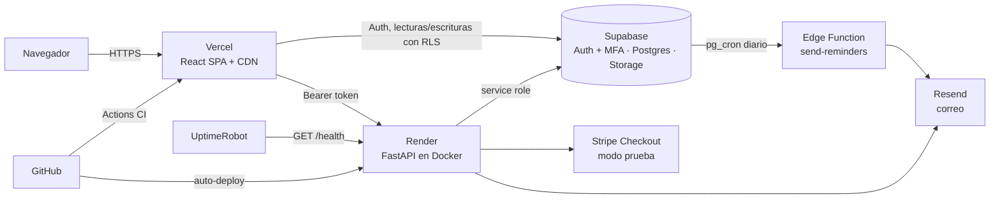

# ⚽ CanchaYa

[](https://github.com/emcr30/final-cloud/actions/workflows/ci.yml)

Plataforma **SaaS multi-tenant** para reservar canchas de fútbol en Arequipa. Varios complejos deportivos (tenants) publican sus canchas en la misma plataforma. Los jugadores buscan en un mapa, reservan por horas y pagan en línea. Cada complejo solo ve y administra sus propios datos.

> Trabajo final del curso **Cloud Computing** (Ingeniería de Software).

## En producción

| Servicio | URL |
|---|---|
| Aplicación (Vercel) | https://final-cloud-liard.vercel.app |
| API (Render) | https://canchaya-api-e2nd.onrender.com — salud: [`/health`](https://canchaya-api-e2nd.onrender.com/health) · documentación: [`/docs`](https://canchaya-api-e2nd.onrender.com/docs) |
| Estado del servicio | https://final-cloud-liard.vercel.app/estado |
| Base de datos, Auth y Storage | Supabase (proyecto `cancha-final`) |

Monitoreo: UptimeRobot consulta `/health` cada 5 minutos (además evita que Render se duerma).

## Roles

| Rol | Qué hace | MFA |
|---|---|---|
| `admin` | Gestiona usuarios y roles, aprueba/suspende complejos, ve métricas globales | Obligatorio |
| `propietario` | Gestiona sus complejos, canchas, precios y horarios; ve su agenda y métricas | Obligatorio |
| `jugador` | Busca canchas (lista + mapa), reserva, paga, ve/cancela sus reservas | Opcional |

## Arquitectura



| Capa | Tecnología | Carpeta |
|---|---|---|
| Frontend | React + Vite + TypeScript, Tailwind CSS, React Router, Recharts, react-leaflet | `frontend/` |
| Backend | Python 3.12, FastAPI, Supabase, Stripe, Resend (Docker) | `backend/` |
| Base de datos | Supabase Postgres con RLS, migraciones SQL, Edge Functions | `supabase/` |

## Cómo correr en local

### Requisitos
- Node.js 20+ y npm
- Python 3.12
- (Opcional) Docker y Supabase CLI

### Frontend
```bash
cd frontend
cp .env.example .env      # completa VITE_SUPABASE_URL, VITE_SUPABASE_ANON_KEY, VITE_API_URL
npm install
npm run dev               # http://localhost:5173
```

### Backend
```bash
cd backend
cp .env.example .env      # completa las claves (Supabase service role, Stripe, Resend…)
python3.12 -m venv .venv
source .venv/bin/activate
pip install -r requirements.txt
uvicorn app.main:app --reload   # http://localhost:8000  ·  docs en /docs
pytest                          # pruebas
```

### Backend con Docker (opcional)
```bash
cd backend
docker build -t canchaya-api .
docker run --env-file .env -p 8000:8000 canchaya-api
```

## Estructura

```
.
├── frontend/                # SPA React (Vercel) · vercel.json
│   └── src/pages/           # canchas/, jugador/, propietario/, admin/, auth/, pago/, Estado.tsx
├── backend/                 # API FastAPI (Render, Docker)
│   ├── app/
│   │   ├── main.py          # app, CORS, rate limit, routers
│   │   ├── config.py        # variables de entorno (pydantic-settings)
│   │   ├── deps.py          # validación del token Supabase, rol y MFA (AAL2)
│   │   ├── limites.py       # rate limit (slowapi)
│   │   ├── routers/         # health, me, pagos, tareas, reportes, admin
│   │   └── servicios/       # Stripe, Resend, PDF
│   └── tests/               # pytest (43 pruebas)
├── supabase/
│   ├── migrations/          # SQL: tablas, RLS, vistas, métricas, cron (recordatorios y limpieza)
│   ├── tests/               # prueba de aislamiento multi-tenant
│   ├── functions/send-reminders/  # Edge Function (Deno)
│   └── seed.sql             # complejos demo en Arequipa
├── scripts/                 # usuarios demo, prueba de carga
├── render.yaml              # Blueprint de Render
└── .github/workflows/ci.yml # CI: lint, build, pytest, Docker
```

## Usuarios demo

`admin@canchaya.demo`, `propietario1@canchaya.demo`, `propietario2@canchaya.demo`, `jugador@canchaya.demo` y otros jugadores `@canchaya.demo`.
Se crean con `backend/.venv/bin/python scripts/crear_usuarios_demo.py`, usando la contraseña de `DEMO_PASSWORD` en `backend/.env` (no se publica en el repositorio). Tarjeta de prueba de Stripe: `4242 4242 4242 4242`.
