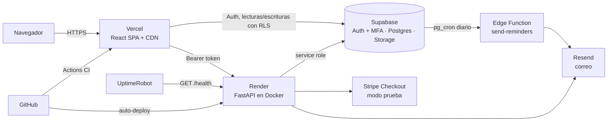

# ⚽ CanchaYa

Plataforma **SaaS multi-tenant** para reservar canchas de fútbol en Arequipa. Varios complejos deportivos (tenants) publican sus canchas en la misma plataforma. Los jugadores buscan en un mapa, reservan por horas y pagan en línea. Cada complejo solo ve y administra sus propios datos.

> Trabajo final del curso **Cloud Computing** (Ingeniería de Software).

## Roles

| Rol | Qué hace | MFA |
|---|---|---|
| `admin` | Gestiona usuarios y roles, aprueba/suspende complejos, ve métricas globales | Obligatorio |
| `propietario` | Gestiona sus complejos, canchas, precios y horarios; ve su agenda y métricas | Obligatorio |
| `jugador` | Busca canchas (lista + mapa), reserva, paga, ve/cancela sus reservas | Opcional |

## Arquitectura



| Capa | Tecnología | Carpeta |
|---|---|---|
| Frontend | React + Vite + TypeScript, Tailwind CSS, React Router, Recharts, react-leaflet | `frontend/` |
| Backend | Python 3.12, FastAPI, Supabase, Stripe, Resend (Docker) | `backend/` |
| Base de datos | Supabase Postgres con RLS, migraciones SQL, Edge Functions | `supabase/` |
| Documentación | Diagramas, avance, notas del informe | `docs/` |

## Cómo correr en local

### Requisitos
- Node.js 20+ y npm
- Python 3.12
- (Opcional) Docker y Supabase CLI

### Frontend
```bash
cd frontend
cp .env.example .env      # completa VITE_SUPABASE_URL, VITE_SUPABASE_ANON_KEY, VITE_API_URL
npm install
npm run dev               # http://localhost:5173
```

### Backend
```bash
cd backend
cp .env.example .env      # completa las claves (Supabase service role, Stripe, Resend…)
python3.12 -m venv .venv
source .venv/bin/activate
pip install -r requirements.txt
uvicorn app.main:app --reload   # http://localhost:8000  ·  docs en /docs
pytest                          # pruebas
```

### Backend con Docker (opcional)
```bash
cd backend
docker build -t canchaya-api .
docker run --env-file .env -p 8000:8000 canchaya-api
```

## Estructura

```
.
├── frontend/          # SPA React (Vercel)
├── backend/           # API FastAPI (Render, Docker)
│   ├── app/
│   │   ├── main.py    # app, CORS, routers
│   │   ├── config.py  # variables de entorno (pydantic-settings)
│   │   ├── deps.py    # validación del token Supabase y rol
│   │   └── routers/   # endpoints por módulo
│   └── tests/
├── supabase/
│   ├── migrations/    # SQL: tablas, RLS, vistas
│   └── functions/     # Edge Functions (Deno)
└── docs/              # AVANCE.md y material del informe
```

Avance detallado por partes: [docs/AVANCE.md](docs/AVANCE.md).
