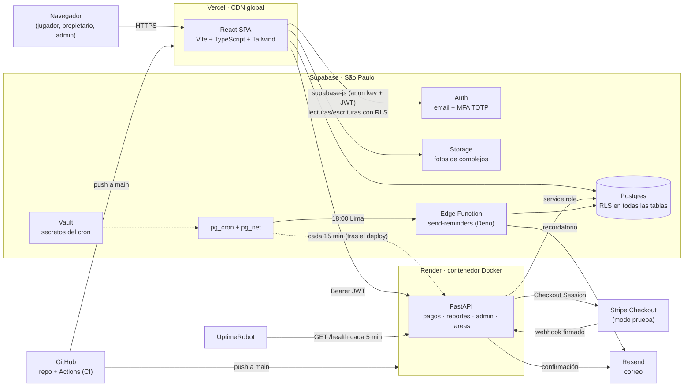
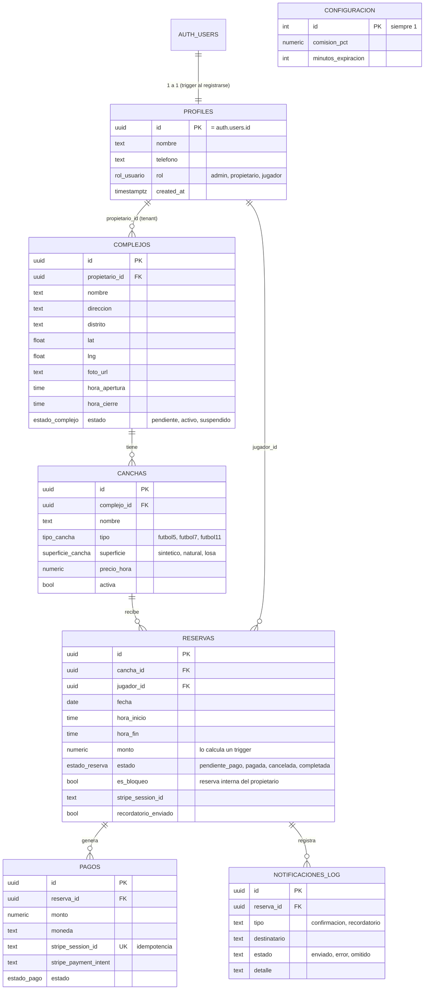
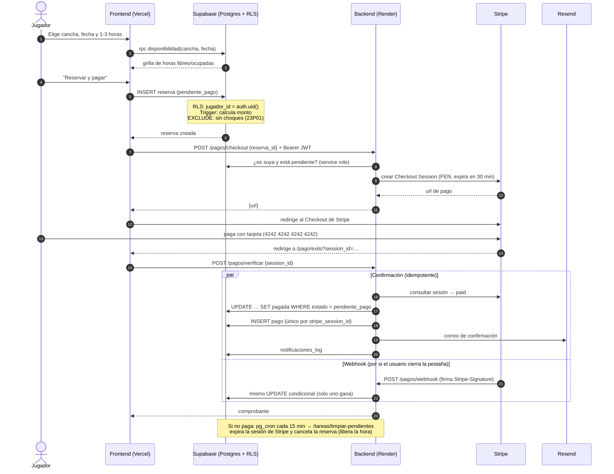
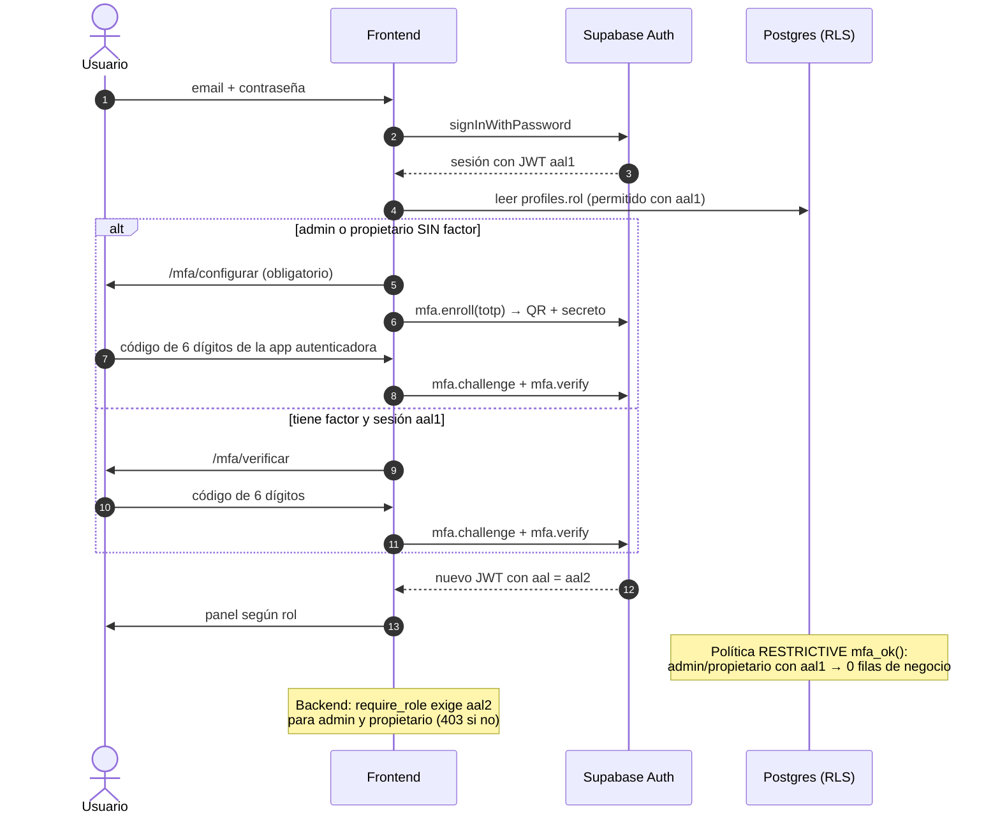
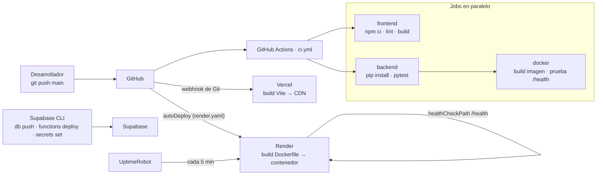

# Arquitectura de CanchaYa

CanchaYa es un **SaaS multi-tenant**: varios complejos deportivos (tenants) comparten la misma aplicación y la misma base de datos, y cada uno ve solo sus datos. El aislamiento lo hace **Row Level Security (RLS)** de Postgres, no el código de la aplicación.

Se eligió la **Opción B**: el navegador habla directo con Supabase para lo simple (protegido por RLS) y con un backend propio para lo que necesita secretos (Stripe, correo, service role).

## 1. Arquitectura cloud

| Capa | Servicio | Modelo cloud | Qué hace |
|---|---|---|---|
| Presentación | **Vercel** | PaaS / CDN | Sirve la SPA compilada desde la red global; HTTPS automático; despliegue en cada push. |
| Lógica con secretos | **Render** | PaaS (contenedor Docker) | API FastAPI: pagos (Stripe), correo (Resend), reportes CSV/PDF, panel admin, tareas programadas. |
| Datos y auth | **Supabase** | BaaS (DBaaS + Auth + Storage + FaaS) | Postgres administrado, RLS, autenticación con MFA, archivos, Edge Functions, cron. |
| Pagos | **Stripe** | SaaS | Checkout alojado por Stripe (el número de tarjeta nunca pasa por nuestros servidores). |
| Correo | **Resend** | SaaS | Envío transaccional (confirmación y recordatorio). |
| CI/CD | **GitHub Actions** | SaaS | Lint, build, pruebas e imagen Docker en cada push. |
| Monitoreo | **UptimeRobot** | SaaS | Disponibilidad de `/health` cada 5 min (y evita que Render se duerma). |

### ¿Por qué esta división?
- **Lo simple va directo a Supabase** (buscar canchas, crear una reserva, editar canchas): menos código y menos latencia. La seguridad no depende del frontend: RLS decide qué filas se ven o se modifican.
- **Lo que necesita secretos va al backend**: la llave de Stripe, la de Resend y la *service role* de Supabase nunca llegan al navegador.
- **Lo periódico vive en la base**: `pg_cron` dispara la Edge Function y la limpieza, sin servidores extra.

## 2. Modelo de datos (ER)

Reglas clave en la base:
- **`reservas_sin_solapamiento`**: restricción `EXCLUDE USING gist (cancha_id WITH =, tsrange(fecha+hora_inicio, fecha+hora_fin) WITH &&) WHERE estado <> 'cancelada'`. Dos personas no pueden reservar la misma cancha a la misma hora aunque pulsen a la vez: la base rechaza la segunda (`23P01`).
- **Trigger `validar_reserva`**: calcula el monto (el cliente no puede inventar el precio), exige horario de atención y que no sea en el pasado.
- **Vistas y funciones de métricas** (`v_*`, `metricas()`, `resumen_jugador()`) con `security_invoker`: respetan RLS.

## 3. Flujo de reserva y pago

## 4. Login con MFA (TOTP)

## 5. Despliegue y CI/CD

- **Infraestructura como código**: `render.yaml` (Blueprint), `frontend/vercel.json`, `supabase/migrations/*.sql`, `supabase/config.toml`, `.github/workflows/ci.yml`.
- **Migraciones versionadas**: cada cambio de la base es un archivo SQL con fecha; `supabase db push` aplica solo los nuevos.
- **Health checks**: Render reinicia el contenedor si `/health` deja de responder; UptimeRobot alerta por correo.
